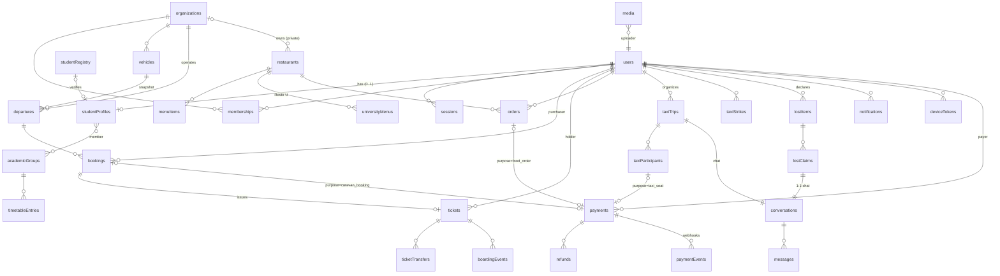

# 03 — MongoDB design

Conventions:

- `_id: ObjectId`; `createdAt` and `updatedAt` are UTC `Date` on every document.
- Money is an integer in XOF.
- `?` marks an optional field.
- Each collection gets a `$jsonSchema` validator (`validationLevel: strict`, `validationAction: error`) and its indexes from versioned migrations.
- **Embedding rule:** embed when a list is bounded and always read with its parent (stops, order lines, menu dishes). Reference when a list is unbounded or written independently (messages, bookings, notifications).

---

## 1. Relationship diagram



---

## 2. Collections

### identity

**`otpChallenges`**

| Field | Type | Notes |
|---|---|---|
| purpose | `'register' \| 'reset_password'` | |
| phone | string (E.164) | |
| codeHash | string | HMAC-SHA256(code, OTP_PEPPER). The code is never stored in clear. |
| attempts / maxAttempts | int | 5 |
| sendCount / lastSentAt | int / Date | Resend allowed after 60 s, max 3 sends per challenge |
| channel | `'sms' \| 'whatsapp' \| 'email'` | |
| status | `'pending' \| 'verified' \| 'locked' \| 'expired'` | |
| expiresAt | Date | now + 5 min |
| ip, userAgentHash | string | Abuse analysis |

Indexes:
- `{phone, purpose, status}`
- TTL `{expiresAt}` with `expireAfterSeconds: 86400` (kept 24 h for abuse analysis)

Per-phone and per-IP daily limits live in Redis.

**`sessions`** (refresh tokens)

| Field | Type | Notes |
|---|---|---|
| userId | ObjectId | |
| familyId | ObjectId | Every rotation of one login shares the family |
| tokenHash | string | SHA-256 of a 256-bit random token. **Unique.** |
| status | `'active' \| 'rotated' \| 'revoked'` | Presenting a `rotated` token means **reuse**, so the whole family is revoked |
| replacedBy? | ObjectId | |
| device | `{id?, platform, appVersion}` | |
| ip, createdAt, lastUsedAt | | |
| expiresAt | Date | Sliding 30 days, capped at an absolute 90 days from the family start |

Indexes:
- `{tokenHash}` unique
- `{userId, status}`
- `{familyId}`
- TTL `{expiresAt}`

### accounts

**`users`** (one document per human, whatever their capabilities)

| Field | Type | Notes |
|---|---|---|
| phone | string E.164 | **Unique.** Login identifier. |
| phoneVerifiedAt | Date | |
| passwordHash | string | Argon2id |
| firstName, lastName | string | |
| status | `'active' \| 'locked' \| 'suspended' \| 'deleted'` | |
| platformRoles | string[] | `admin`, `content_editor`, `resto_u_staff`, `lost_office`, `academic_editor`, `finance`. **Granted by admins only.** |
| login | `{failedCount, lockedUntil?, lastLoginAt?}` | |
| terms | `{version, acceptedAt}` | |
| notificationPrefs | `{social: bool, cours: bool, paiements: bool}` | Embedded, bounded |
| taxi | `{suspendedUntil?: Date}` | Cache; the source of truth is `taxiStrikes` |
| email | `{address, verifiedAt: Date \| null, addedAt} \| null` | Added after sign-up, optional. Lower-cased. **Unique** when present. Not a login identifier. Unverified until an e-mail provider exists (Q-14). |
| avatar | `{mediaId, url} \| null` | Profile picture. Set only by the media module after validation and re-encoding; clients never send URLs. |
| lastLocation | `{point: GeoJSON Point [lng, lat], accuracyM: number \| null, updatedAt} \| null` | Last position reported by the app, for future features. Personal data: only returned to the user themself, sent only with the OS location permission, deletable (`DELETE /me/location`). |
| deletedAt? | Date | Soft delete, then anonymization job |

Indexes:
- `{phone}` unique
- `{platformRoles}` sparse
- `{email.address}` unique, partial (`email.address` is a string)
- `{lastLocation.point: '2dsphere'}` (documents without a position are skipped)

**`studentProfiles`** (0..1 per user; organizer-only accounts have none)

| Field | Type | Notes |
|---|---|---|
| userId | ObjectId | **Unique** |
| studentNumber | string `^P\d{6}$` | **Unique** |
| campus | `'campus1' \| 'campus2'` | |
| onCampus | bool | `village` and `room` are set only when true |
| village?, room? | string | |
| ufr?, filiere?, niveau? | string | Not collected at sign-up today (Q-13) |
| academicGroupIds | ObjectId[] | Bounded (≤ 5) |
| verification | `{status: 'unverified' \| 'verified', registryId?, verifiedAt?}` | See Q-6 |

Indexes:
- `{userId}` unique
- `{studentNumber}` unique
- `{academicGroupIds}`
- `{campus}`

**`studentRegistry`** (an import from the university, if available, Q-6)

| Field | Type | Notes |
|---|---|---|
| studentNumber | string | Unique |
| cardNumberHash | string | HMAC of the card barcode digits. Used for lost-card lookup. The raw number is not stored. |
| firstName, lastName | string | Only `firstName` and the last-name initial are ever returned |
| ufr, filiere, niveau, academicYear | string | |
| importedAt, importBatchId | | |

Indexes:
- `{studentNumber}` unique
- `{cardNumberHash}` unique sparse

**`userBlocks`** `{userId, blockedUserId, createdAt}`
- unique `{userId, blockedUserId}`

### organizations

**`organizations`**

| Field | Type | Notes |
|---|---|---|
| slug | string | Unique |
| name | string | |
| category | `'Entreprise' \| 'Amicale' \| 'Transporteur' \| 'Restaurant'` | Renamed from `kind` (migration `2026-10-31-organizations-kind-to-category`) |
| email | string \| null | Contact address, set at creation or later by an admin or the owner. Not unique. |
| logo | `{mediaId, url} \| null` | Logo / profile picture, set by the media module |
| capabilities | `('caravans' \| 'restaurant')[]` | |
| level | `'nouveau' \| 'verifie' \| 'confirme'` | Set by an admin for now (there is no rating UI) |
| stats | `{ratingAvg?: number, ratingCount: int, tripsCount: int}` | Denormalized, updated by jobs |
| status | `'pending' \| 'active' \| 'suspended'` | |
| verification | `{documentsCheckedAt?, checkedBy?}` | |
| payout | `{provider: 'wave' \| 'orange_money', accountMasked, accountEnc}` | Encrypted |

**`memberships`** `{orgId, userId, roles: ('owner'|'manager'|'scanner'|'staff')[], status: 'invited'|'active'|'revoked', grantedBy}`

Indexes:
- unique `{orgId, userId}`
- `{userId, status}`

`GET /me` reads these to build `spaces` and the organization list.

### content

**`announcements`**

| Field | Type | Notes |
|---|---|---|
| type | `'headline' \| 'alert' \| 'ad'` | |
| official | bool | Only `content_editor`/`admin` may set `true` |
| tag | string | "Élections", "Resto 1" |
| title, subtitle | string | |
| tone | `'purple' \| 'danger' \| 'orange' \| 'success' \| 'primary'` | **Semantic tone, not colours.** The client keeps its theme. |
| icon | string | Ionicons name (validated against an allowlist) |
| urgent | bool | |
| link | `{href?: string (app route allowlist), url?: string (https only)}` | |
| cta? | string | Ads |
| imageMediaId? | ObjectId | |
| audience | `{all: true} \| {campuses?, ufrs?, niveaux?}` | |
| priority | int | |
| status | `'draft' \| 'scheduled' \| 'published' \| 'archived'` | |
| publishAt, expiresAt? | Date | |
| source | `'manual' \| 'stock_auto'` | Optional auto-headlines from Resto U stock (Q-11) |
| createdBy, updatedBy | ObjectId | |

Indexes:
- `{type, status, publishAt, expiresAt, priority}`
- TTL none (we keep the history)

### places

**`places`**

| Field | Type | Notes |
|---|---|---|
| slug, name, description, area | string | |
| category | `'Études' \| 'Restauration' \| 'Services' \| 'Sport' \| 'Santé'` | |
| location | GeoJSON Point `{type:'Point', coordinates:[lng, lat]}` | |
| photos | ObjectId[] (media) | 1–3 |
| hours? | string | Display text, matching the frontend |
| icon | string | |
| status | `'draft' \| 'published'` | |

Indexes:
- `{location: '2dsphere'}`
- `{status, category}`
- text `{name, area, description}` with `default_language: 'french'`

### food

**`restaurants`**

| Field | Type | Notes |
|---|---|---|
| type | `'university' \| 'private'` | |
| orgId? | ObjectId | Set for private restaurants |
| campusId | `'campus1' \| 'campus2'` | |
| name, kind, location, phone | string | |
| services | `[{start:'13:00', end:'15:00', days?: int[]}]` | Bounded. The open state is computed on the server in Africa/Dakar time. |
| deliveryFee | int \| null | `null` = no delivery |
| acceptingOrders | bool | Manual pause |
| coverMediaId?, icon, tone | | |
| status | `'draft' \| 'published' \| 'suspended'` | |

Indexes:
- `{type, campusId, status}`
- `{orgId}`

**`menuItems`** (private restaurants)

| Field | Type | Notes |
|---|---|---|
| restaurantId | ObjectId | |
| section | `'menu' \| 'drink'` | |
| name, detail | string | |
| price | int > 0 | **The only price source for orders** |
| photoMediaId? / photoUrl? | | |
| available | bool | The daily toggle ("menus du jour") |
| sortOrder | int | |
| archivedAt? | Date | Never hard-deleted, because old orders keep a snapshot anyway |

Index: `{restaurantId, section, available, sortOrder}`

**`universityMenus`** (Resto U)

| Field | Type | Notes |
|---|---|---|
| restaurantId | ObjectId | |
| date | string `YYYY-MM-DD` (Dakar) | |
| meal | `'lunch' \| 'dinner'` | |
| dishes | `[{_id, name, detail, status: 'available'\|'low'\|'critical'\|'out', portionsLeft?: int, updatedAt, updatedBy}]` | Embedded, ≤ 6 |

Indexes:
- unique `{restaurantId, date, meal}`
- TTL none (small)

Stock updates use a positional update on `dishes._id`, conditioned on the previous `updatedAt` (optimistic concurrency) or `$inc` with `portionsLeft >= n`.

**`orders`**

| Field | Type | Notes |
|---|---|---|
| code | string | e.g. `C7K2QX`. Unique, shown to staff. |
| userId, restaurantId | ObjectId | |
| lines | `[{itemId, name, unitPrice, qty (1..20), lineTotal}]` | **Snapshot at order time**, embedded (≤ 30 lines) |
| subtotal, deliveryFee, total | int | **Computed on the server** |
| mode | `'pickup' \| 'delivery'` | |
| address?, note? | string (≤ 200) | |
| paymentId | ObjectId | |
| status | see §4 | |
| statusHistory | `[{status, at, by?}]` | Bounded by the state machine (≤ 8) |
| idempotencyKey | string | |

Indexes:
- `{code}` unique
- `{userId, createdAt: -1}`
- `{restaurantId, status, createdAt: -1}`
- unique `{userId, idempotencyKey}`

### payments

**`payments`**

| Field | Type | Notes |
|---|---|---|
| reference | string | `PAY_<ulid>`. Unique. Sent to the provider as `client_reference`. |
| userId | ObjectId | |
| purpose | `'food_order' \| 'caravan_booking' \| 'taxi_seat'` | |
| purposeRef | ObjectId | |
| amount | int | |
| currency | `'XOF'` | |
| provider | `'wave' \| 'orange_money' \| 'simulated'` | |
| providerSessionId?, providerTxnId? | string | |
| checkoutUrl? | string | |
| status | `'created' \| 'pending' \| 'succeeded' \| 'failed' \| 'expired' \| 'cancelled'` | |
| fulfillment | `'pending' \| 'fulfilled' \| 'unfulfillable'` | Set by the purpose handler |
| refundedAmount | int | |
| expiresAt | Date | |
| statusHistory | `[{status, at, source: 'webhook'\|'poll'\|'system'}]` | |

Indexes:
- `{reference}` unique
- `{provider, providerTxnId}` unique sparse
- `{status, expiresAt}` (reconciliation)
- `{purpose, purposeRef}`
- `{userId, createdAt: -1}`

**`paymentEvents`** (webhook inbox; the key to duplicate protection)

| Field | Type | Notes |
|---|---|---|
| provider | string | |
| providerEventId | string | The provider's event ID, or a hash of the body if it has none |
| type | string | |
| payload | object | Raw body (provider data only, no card data) |
| signatureValid | bool | Invalid payloads are stored for forensics and never processed |
| receivedAt, processedAt?, outcome? | | |

Indexes:
- **unique `{provider, providerEventId}`**: a duplicate webhook hits E11000, so we return 200 and do nothing.
- `{processedAt: 1}` sparse (sweeper)

**`refunds`**

| Field | Type | Notes |
|---|---|---|
| paymentId | ObjectId | |
| amount | int | |
| reason | `'ticket_cancelled' \| 'departure_cancelled' \| 'min_not_reached' \| 'taxi_left' \| 'taxi_cancelled' \| 'order_rejected' \| 'late_payment_unfulfillable'` | |
| status | `'requested' \| 'processing' \| 'succeeded' \| 'failed' \| 'manual_required'` | |
| providerRefundId? | string | |
| idempotencyKey | string | Unique, e.g. `ticket:<id>:cancel` |

Indexes:
- `{idempotencyKey}` unique
- `{status}`

**`payouts`** (money owed to organizers / taxi organizers)

| Field | Type | Notes |
|---|---|---|
| beneficiary | `{type: 'org'\|'user', id}` | |
| source | `{type: 'departure'\|'taxi_trip', id}` | |
| amount | int | |
| status | `'accruing' \| 'available' \| 'processing' \| 'paid' \| 'manual_required'` | |
| availableAt | Date | |

Index: unique `{source.type, source.id, beneficiary.id}`

Execution stays **manual** until the payout API and the legal model are confirmed (Q-1, Q-2).

### caravans

**`vehicles`** `{orgId, label, plate (unique), capacity, layout: {seatsPerRow: 4, rows, blockedSeats: int[]}, verifiedAt?}`

**`departures`**

| Field | Type | Notes |
|---|---|---|
| code | string | Short, unique (`DK0903A`) |
| orgId, vehicleId | ObjectId | |
| vehicle | `{label, plate, capacity, layout}` | Snapshot |
| direction | `'aller' \| 'retour'` | |
| from, to | string | |
| departureAt | Date | |
| pickups / dropoffs | `[{stopId, place, scheduledAt: Date}]` | Embedded, ≤ 15 each |
| price | int | |
| minPassengers | int | |
| confirmBy | Date | |
| status | `'draft' \| 'published' \| 'confirmed' \| 'cancelled' \| 'departed' \| 'completed'` | |
| seatsTaken | int | Held + confirmed. Counter kept in the **same transaction** as the booking writes. Used for listings only; the authority is the unique index. |
| seatsConfirmed | int | |
| stopsLeft | `[{stopId, at, by}]` | "Le bus repart de cet arrêt" |
| bookingOpensAt?, bookingClosesAt | Date | Default close = departureAt − 30 min (Q) |

Indexes:
- `{status, direction, departureAt}`
- `{orgId, departureAt: -1}`
- `{code}` unique

**`bookings`** (a purchase attempt and the seat it holds)

| Field | Type | Notes |
|---|---|---|
| departureId, userId | ObjectId | `userId` = purchaser |
| seat | int | |
| pickupStopId, dropoffStopId | string | Validated: the dropoff comes after the pickup on the route |
| price | int | Copied from the departure on the server |
| status | `'held' \| 'confirmed' \| 'cancelled' \| 'expired'` | |
| **seatActive** | bool | `true` while `held` or `confirmed`. Set to `false` atomically on cancel or expiry. |
| **countsForLimit** | bool | `true` for held/confirmed, **including after the ticket is transferred**, so the purchaser can't buy again (frontend rule). `false` when cancelled or expired. |
| holdExpiresAt | Date | now + 10 min (Q-5) |
| paymentId? | ObjectId | |
| idempotencyKey | string | |

Indexes:
- **unique partial `{departureId, seat}` where `{seatActive: true}`**: two students can never hold the same seat.
- **unique partial `{departureId, userId}` where `{countsForLimit: true}`**: one booking per student per departure.
- `{status, holdExpiresAt}` (sweeper)
- unique `{userId, idempotencyKey}`

**`tickets`**

| Field | Type | Notes |
|---|---|---|
| bookingId | ObjectId | **Unique.** One ticket per confirmed booking, which makes confirmation idempotent. |
| departureId | ObjectId | |
| holderUserId | ObjectId | Changes on transfer |
| purchaserUserId | ObjectId | Never changes. Receives refunds (Q-3). |
| code | string | 6 characters of Crockford base32. **Random**, unique per departure. For manual entry. |
| seat, pickupStopId, dropoffStopId | | |
| status | `'active' \| 'cancelled'` | |
| version | int | Incremented on every transfer, which **invalidates old QR codes** |
| boardedAt? | Date | Cache of the boarding state |
| cancellation? | `{at, fee, refundAmount, refundId}` | |

Indexes:
- `{bookingId}` unique
- unique `{departureId, code}`
- `{holderUserId, status}`
- `{departureId, status}`

**`ticketTransfers`** `{ticketId, fromUserId, toUserId, status: 'pending'|'accepted'|'declined'|'cancelled'|'expired', ticketVersionAtCreation, expiresAt, respondedAt?}`

Indexes:
- **unique partial `{ticketId}` where `{status: 'pending'}`**: one transfer in flight at a time.
- `{toUserId, status}`

**`boardingEvents`** (append-only, auditable)

| Field | Type | Notes |
|---|---|---|
| ticketId, departureId | ObjectId | |
| stopId | string | Where the bus was |
| method | `'qr' \| 'code'` | |
| result | `'boarded' \| 'duplicate' \| 'rejected'` | |
| reason? | `'wrong_departure' \| 'cancelled' \| 'bad_signature' \| 'stale_version' \| 'unknown'` | |
| scannedBy, deviceId | | |
| clientScanId | string (UUID) | **Unique.** Makes offline batch sync idempotent. |
| scannedAt (device), receivedAt (server) | Date | |
| voided? | `{at, by, reason}` | "Unboard" never deletes |
| **activeBoarding** | bool | `true` only for `result: 'boarded'` that is not voided |

Indexes:
- `{clientScanId}` unique
- **unique partial `{ticketId}` where `{activeBoarding: true}`**: no duplicate boarding, even across phones.
- `{departureId, receivedAt}`

### taxi

**`taxiTrips`**

| Field | Type | Notes |
|---|---|---|
| organizerUserId | ObjectId | |
| from, to | string (≤ 80) | |
| departureAt | Date | Between now + 15 min and now + 7 days (Q) |
| seats | int 2..8 | Organizer included |
| fare | int 500..50 000 | Bounds to confirm |
| seatPrice | int | `ceil(fare / seats / 50) * 50`, **computed on the server** |
| seatsTaken | int | Organizer + paid + pending-payment holds |
| lockAt | Date | departureAt − 30 min |
| chatClosesAt | Date | departureAt + 2 h |
| status | `'open' \| 'departed' \| 'cancelled' \| 'completed'` | |
| vehicle? | `{model, color, plate}` | |
| conversationId | ObjectId | |
| handover? | `{toUserId, requestedAt, expiresAt}` | |
| departedAt? | Date | |

Indexes:
- `{status, departureAt}`
- `{organizerUserId, status}`

**`taxiParticipants`**

| Field | Type | Notes |
|---|---|---|
| tripId, userId | ObjectId | |
| role | `'organizer' \| 'passenger'` | |
| status | `'pending_payment' \| 'joined' \| 'left' \| 'removed' \| 'expired'` | |
| paymentId? | ObjectId | |
| joinedAt, joinOrder | | `joinOrder` decides the hand-over target |
| checkedInAt?, leftAt? | | |
| refund? | `{amount, refundId}` | |
| **active** | bool | `true` while `pending_payment` or `joined` |
| **activeTrip** | bool | `true` while the trip isn't departed, cancelled or completed (and ≤ 15 min after its time) |

Indexes:
- unique partial `{tripId, userId}` where `{active: true}`
- **unique partial `{userId}` where `{activeTrip: true}`**: one active trip per student, enforced by the database.
- `{tripId, status}`

**`taxiStrikes`** `{userId, tripId, reason: 'late_cancel', at}`
- `{userId, at: -1}`
- unique `{tripId, userId}`

### lostfound

**`lostItems`**

| Field | Type | Notes |
|---|---|---|
| reporterUserId | ObjectId | |
| status | `'found' \| 'lost'` | |
| categoryId | string | Validated against the category list |
| kind | `'student-card' \| 'id-card' \| 'object'` | |
| name | string | |
| details? | string | Public |
| secretEnc? | string | **AES-256-GCM** (key ring with key ID). Decrypted only for the reporter. |
| where, spot? | string | |
| occurredAt | Date | |
| holder? | `'office' \| 'finder'` | |
| photoMediaId? | ObjectId | Required if `found` and `object`; **rejected for cards** |
| ownerHint? | string | "Awa D." Cards only, derived from the registry (Q-7) |
| ownerUserId? | ObjectId | **Private.** Never serialized to other users. |
| ownerNotifiedAt? | Date | |
| state | `'open' \| 'claimed' \| 'returned' \| 'closed' \| 'hidden'` | |
| moderation | `{reportCount, hiddenAt?, hiddenBy?}` | |
| expiresAt | Date | Auto-close after 60 days (Q) |

Indexes:
- `{state, status, categoryId, createdAt: -1}`
- text `{name, details, where}` (french)
- `{reporterUserId}`
- `{ownerUserId}` sparse

**`lostClaims`** `{itemId, claimantUserId, type: 'owner_claim'|'finder_report', proofEnc?, status: 'pending'|'accepted'|'rejected'|'withdrawn', conversationId, decidedAt?}`

Indexes:
- unique partial `{itemId, claimantUserId}` where `{status: 'pending'}`
- `{itemId, status}`

**`cardScans`** `{finderUserId, cardNumberHash, matched: bool, itemId?, at}`
- `{finderUserId, at}` (enumeration detection)
- TTL 180 days

**`lostReports`** `{itemId, reporterUserId, reason}`
- unique `{itemId, reporterUserId}`

### messaging

**`conversations`**

| Field | Type | Notes |
|---|---|---|
| type | `'taxi_trip' \| 'lost_claim'` | |
| contextRef | ObjectId | |
| participantIds | ObjectId[] | Bounded: taxi ≤ 8, claim = 2 |
| writableUntil? | Date | |
| status | `'open' \| 'closed'` | |
| lastMessageAt | Date | |
| deleteAfter? | Date | TTL on the conversation, plus a cascade job |

**`messages`**

| Field | Type | Notes |
|---|---|---|
| conversationId | ObjectId | |
| authorId? | ObjectId | Absent = system line |
| kind | `'text' \| 'system' \| 'quick_reply' \| 'pin'` | |
| body | string (≤ 1000) | |
| clientMessageId? | string | |

Indexes:
- `{conversationId, _id: -1}` (pagination)
- unique partial `{conversationId, authorId, clientMessageId}` (idempotent sends)

Retention: deleted 90 days after the conversation closes (Q-20).

**`conversationReads`** `{conversationId, userId, lastReadMessageId}`
- unique `{conversationId, userId}`

### notifications

**`notifications`**

| Field | Type | Notes |
|---|---|---|
| userId | ObjectId | |
| category | `'social' \| 'cours' \| 'paiements'` | |
| type | string | e.g. `ticket.confirmed` |
| title, body | string | **No sensitive data** (no full names of others, no numbers) |
| icon, tone | string | |
| deepLink? | string | App route allowlist (`/billet/:id`…) |
| dedupeKey | string | e.g. `ticket.confirmed:<ticketId>` |
| readAt? | Date | |
| push | `{status: 'pending'\|'sent'\|'failed'\|'skipped', attempts, lastError?}` | |
| expireAt | Date | createdAt + 180 days |

Indexes:
- **unique `{userId, dedupeKey}`**: retries can't duplicate a notification.
- `{userId, category, _id: -1}`
- `{userId, readAt}` partial (unread count)
- `{push.status, createdAt}` (sweeper)
- TTL `{expireAt}`

**`deviceTokens`** `{userId, token (unique), platform, appVersion, lastSeenAt, disabledAt?}`
- `{userId}`

**`pushDeliveries`** `{notificationId, tokenId, expoTicketId, status, receiptCheckedAt?, error?}`
- TTL 30 days

**`broadcasts`** `{audience, title, body, deepLink, category, createdBy, status: 'queued'|'fanning_out'|'done'|'failed', cursor, counts}`

Fan-out is **on write** with TTL. At 15 k users this is about 15 k small documents per broadcast. That is cheap, and it keeps read/unread logic trivial. We would revisit with fan-out-on-read above roughly 200 k users.

### media, academics, scholarships, audit, platform

- **`media`** `{ownerUserId, purpose, storageKey, contentType: 'image/webp', bytes, width, height, visibility: 'public'|'private', status: 'pending'|'ready'|'rejected', sha256}`
  - `{ownerUserId, createdAt}`
  - orphan sweeper: `status: 'pending'` older than 24 h is deleted
- **`academicGroups`** `{ufr, filiere, niveau, label, academicYear}`
  - unique on all four fields
- **`timetableEntries`** `{groupId, title, kind: 'CM'|'TD'|'TP', teacher, room, startsAt, endsAt, status: 'scheduled'|'moved'|'cancelled', previous?: {startsAt, room}, changedAt?, changedBy?, importBatchId?}`
  - `{groupId, startsAt}`
- **`scholarshipSchedules`** `{label, paymentDate, methods: ('wave'|'orange_money')[], status, audience}`
  - `{status, paymentDate}`
- **`auditLogs`** `{actor: {type: 'user'|'system'|'provider', id?}, action, target: {type, id}, requestId, ip?, metadata, at}`
  - `{target.type, target.id, at}`
  - `{actor.id, at}`
  - retention 2 years (Q-20)
  - the application only ever inserts (no update/delete permission for the app's DB user in production)
- **`idempotencyKeys`** `{_id: hash(userId, route, key), requestHash, status: 'in_progress'|'done', response?: {statusCode, body}, createdAt}`
  - TTL 24 h
- **`migrations`** `{_id: version, appliedAt}`

---

## 3. Index strategy summary

| Need | Technique |
|---|---|
| Correctness under concurrency | **Partial unique indexes** on boolean "active" flags: seats, one booking per student, one boarding per ticket, one pending transfer, one active taxi trip, one pending claim. Partial filters use plain `{flag: true}` equality, which every supported MongoDB version handles. |
| Duplicate external events | Unique `{provider, providerEventId}`, `{provider, providerTxnId}`, refund `idempotencyKey`, notification `{userId, dedupeKey}`, `clientScanId` |
| Hot reads | Compound indexes matching list queries exactly (ESR order: equality, sort, range) |
| Geo | `2dsphere` on `places.location` |
| Search | French text indexes (places, lost items). Small collections, so no external search engine. |
| Expiry | TTL on OTPs, sessions, idempotency keys, notifications, push deliveries, card scans |

Every list endpoint is checked with `explain()` in integration tests (no `COLLSCAN` on large collections).

## 4. State machines

```
Order:     pending_payment ─► received ─► preparing ─► ready ─► done
                │                │
                ├─► payment_failed / expired   └─► rejected (by restaurant, refund)
                └─► cancelled (by user, only before payment)

Booking:   held ─► confirmed            held ─► expired | cancelled (seat released)
           confirmed ─► cancelled (ticket cancelled / departure cancelled)

Ticket:    active ─► cancelled          (transfer = holder change + version++, stays active)
           boarding state lives in boardingEvents (activeBoarding)

Departure: draft ─► published ─► confirmed (min reached) ─► departed ─► completed
                        └──────────► cancelled (by organizer, or min not reached at confirmBy → refund all)

Payment:   created ─► pending ─► succeeded | failed | expired | cancelled
           (succeeded is terminal; fulfillment: pending ─► fulfilled | unfulfillable → auto refund)

Taxi trip: open ─► departed ─► completed           open ─► cancelled
Taxi participant: pending_payment ─► joined ─► left | removed     pending_payment ─► expired
Transfer:  pending ─► accepted | declined | cancelled | expired
Claim:     pending ─► accepted | rejected | withdrawn
```

Each transition is a conditional update: `updateOne({_id, status: <from>}, {$set: {status: <to>}})`. If it matches 0 documents, the transition is rejected (`409 INVALID_STATE`). This is the core concurrency defence.

## 5. Consistency of critical operations

| Operation | Strategy | Transaction? |
|---|---|---|
| Hold a seat | Insert `bookings` (`seatActive: true`) and `$inc departures.seatsTaken` with the guard `{status: 'published'\|'confirmed', bookingClosesAt > now}`. The unique index decides the race: E11000 → `SEAT_TAKEN`; auto-pick moves on to the next candidate. | **Yes** (insert + counter) |
| Confirm a booking after payment | `booking: held→confirmed` (conditional), insert `tickets` (unique `bookingId`), `$inc seatsConfirmed`, check for the `confirmed` departure transition | **Yes** |
| Payment arrives after the hold expired | Try to re-acquire the same seat (insert with `seatActive`). If that succeeds, confirm. Otherwise mark the payment `unfulfillable` and create a refund (Q-5). | Yes |
| Cancel a ticket | `ticket: active→cancelled`, `booking → cancelled`, `seatActive / countsForLimit = false`, `$inc seatsTaken -1`, insert `refunds` (unique idempotency key) | **Yes**. The provider refund call happens after commit, in a job. |
| Transfer accept | `ticket` conditional on `{holderUserId: from, version: v, status: 'active'}` → `holderUserId = to, version = v + 1`, `transfer: pending→accepted` | **Yes** |
| Board | Insert `boardingEvents` with `activeBoarding: true`. A unique index violation means duplicate boarding: insert it as `result: 'duplicate'` and answer "Déjà à bord". | No (single insert decides) |
| Join a taxi | `findOneAndUpdate(trip {status: 'open', seatsTaken < seats, departureAt > now}, $inc seatsTaken)`, then insert a participant (`activeTrip` unique). On E11000, roll back the counter. | **Yes** |
| Webhook | Insert `paymentEvents` (unique), conditional `payment: pending→succeeded`, purpose handler (its own transaction) | Per step; each step is idempotent |
| Resto U stock | `updateOne({_id, 'dishes._id': d}, {$set: {'dishes.$.status': s, …}})` | No |

The deployment **must** be a replica set (dev: single node `rs0`; prod: 3 nodes, `w: 'majority'`, `readConcern: 'majority'` for transactions). Reads of public catalogues may use `secondaryPreferred`. Anything involving money or seats reads from the primary.
